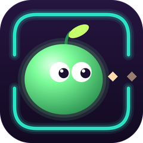

# Maze Muncher 

An original arcade maze-chase game, built as a [golem](https://thinkr-open.github.io/golem/) Shiny app.

A hungry green blob munches seeds through neon mazes. Four sentries hunt it, and each one picks its target its own way:

| Sentry | Colour | Target |
|---|---|---|
| Hunter | magenta | goes straight for the blob |
| Cutter | orange | aims 3 tiles ahead of the blob |
| Pincer | cyan | the Hunter's position mirrored through the blob |
| Drifter | lime | a random spot, re-picked every few seconds |

Grab a power star and the sentries are stunned for a while, so you can eat them for chained bonuses (200, 400, 800, 1600). Gems appear at 30% and 70% of the seeds eaten. You get an extra life at 10,000 points.

## Run it

```r
# from the project root
pkgload::load_all()
run_app()

# or install it first
devtools::install()
mazemuncher::run_app()
```

To store high scores somewhere other than `tools::R_user_dir("mazemuncher", "data")`:

```r
run_app(scores_path = "~/maze-scores.rds")
# or: options(mazemuncher.scores_path = "~/maze-scores.rds")
```

**Controls:** arrow keys or WASD to move, P (or Esc) to pause, swipe on touch screens.

## How the work is split

The game logic that can be tested lives in R. The real-time loop runs in the browser.

| Layer | Files | Responsibility |
|---|---|---|
| R: game data | `R/fct_maze.R`, `R/fct_generate.R`, `R/fct_difficulty.R` | 3 hand-made mazes; a random, mirror-symmetric maze generator (DFS plus braiding, no dead ends); maze validation (reachability, den access, no dead ends, no 2x2 open areas); difficulty settings for each level |
| R: persistence | `R/fct_scores.R` | high-score table saved as an RDS file |
| R: Shiny modules | `R/mod_settings.R`, `R/mod_game.R`, `R/mod_scores.R` | settings, level progression and game-over handling, high-score table |
| JS: engine | `inst/app/www/game.js` | canvas rendering, fixed-timestep loop, movement, sentry AI, collisions |

Messages between the two:

* **R → JS:** `mazemuncher:start` and `mazemuncher:level` carry the level config: maze rows, speeds, the scatter/chase schedule and so on.
* **JS → R:** `input$<id>-event` with `type = "level_cleared"` makes R send the next level. `type = "game_over"` makes R store the score.

## Development

```r
devtools::test()   # maze validity, generator (50 seeds), difficulty, scores, modules
devtools::check()
```
